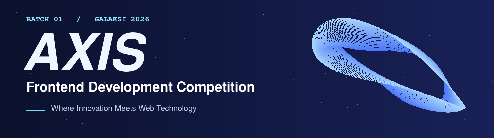

<strong>Application eXcellence in Information Systems</strong> Kompetisi mahasiswa untuk membangun solusi web bagi organisasi dan dunia usaha.

<a href="https://forms.gle/5QWPv4pqVaXKXz3i7"><strong>Daftar tim</strong></a>　·　<a href="https://axis-competition.github.io/axis-2026/guidebook.html"><strong>Baca guidebook</strong></a>　·　<a href="https://forms.gle/z6LmuzqaYRqVUZaNA"><strong>Kumpulkan karya</strong></a>

## Batch 1 · Frontend Development Competition

Edisi perdana AXIS hadir dalam rangkaian **GALAKSI 2026**. Pilih satu masalah organisasi atau bisnis, lalu bangun antarmuka responsif yang memungkinkan pengguna menyelesaikan tugasnya. Framework frontend bebas. Tim dapat menggunakan data simulasi atau API.

> *Empowering Organizations & Digital Enterprises through Innovative and User-Centered Web Interfaces.*

| Peserta | Komposisi tim | Biaya pendaftaran |
| :--- | :--- | :--- |
| Mahasiswa aktif S1 seluruh Indonesia | 2 sampai 4 orang dari satu perguruan tinggi, boleh lintas prodi dan angkatan | Rp50.000 per tim |

### Pilih satu kategori karya

| Kategori | Contoh interaksi pengguna |
| :--- | :--- |
| **A · Business & Enterprise Digitalization** | Menelusuri katalog produk dan memantau persediaan. |
| **B · Organizational Management & Governance** | Mengajukan layanan dan melacak status permohonan. |
| **C · Collaborative Digital Enterprise Platform** | Membagi tugas dan memantau progres proyek tim. |

### Jadwal Batch 1

| Tahap | Waktu |
| :--- | :--- |
| Publikasi | 20 November 2026 |
| Pendaftaran | 20 sampai 30 November 2026 |
| Pengembangan dan pengumpulan | 20 November sampai **9 Desember 2026, pukul 23.59 WIB** |
| Penjurian | 10 sampai 11 Desember 2026 |
| Pengumuman di acara puncak GALAKSI | **12 Desember 2026** |

**Berkas pengumpulan.** Sertakan website aktif, repositori GitHub publik dengan README, ringkasan PDF 3 sampai 5 halaman, dan video demo maksimal 3 menit.

[Gunakan template peserta](https://github.com/axis-competition/submission-template) · [Lihat repositori Batch 1](https://github.com/axis-competition/axis-2026) · [Hubungi panitia](https://wa.me/6285181079659)

---

### Rencana Batch 2 · Web Development Competition

Untuk edisi kedua, panitia berharap dapat menyelenggarakan AXIS secara mandiri dengan cakupan pengembangan aplikasi web yang lebih luas. Format Batch 2 masih dalam tahap perencanaan.
